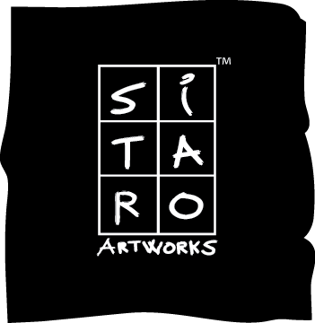
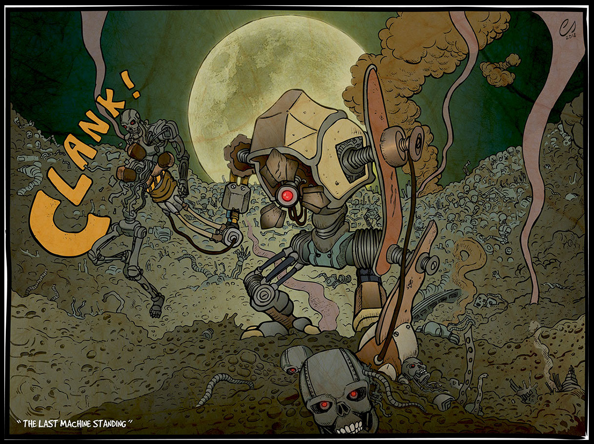
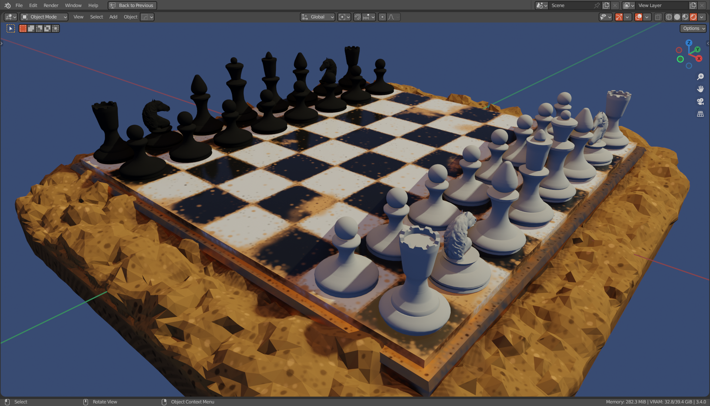

  

# Hi there, I'm Carlo Sitaro 👋
### Graphic Designer | 3D Artist | Hardware Specialist

Welcome to my portfolio! 

I am an independent creator with over 15 years of experience in 2D vector illustration and 8+ years in 3D modeling and 3D prints.

---

## 2D Vector Art & Print Gallery

Specializing in scalable, high-detail vector art, print-ready apparel design, logos, and UI assets.

### 1. Detailed Vector Illustrations & Print Apparel
High-detail line art, custom vector shading, and print-ready CMYK/Pantone vector paths for apparel, t-shirts, mugs and posters.

| Artwork Preview | Title & Description | Technical Details |
| :---: | :--- | :--- |
|  | **Aikido - Way of Life** Dynamic Japanese martial arts vector illustration featuring traditional wave and samurai line art. | Native SVG/EPS, print-ready, high-resolution vector paths. |
|  | **Ronin Senshi - Isolated Vector** Detailed samurai armor line art inked for screen printing and direct-to-garment (DTG) apparel. | Clean vector outlines, separated color layers. |
|  | **Ronin Senshi - Poster Edition** Full poster artwork composition combining traditional Japanese ukiyo-e aesthetic with modern vector techniques. | Print-ready 300 DPI layout, custom vector textures. |
|  | **Scientists' Meeting** Sci-Fi pop-culture mashup poster artwork featuring the Ghostbusters crossing paths with Dr. Isaac Kleiner from Half-Life. | High-detail vector line work, custom comic-style shading & textures. |
|  | **The Last Machine Standing** Sci-Fi crossover poster artwork featuring Dog from Half-Life 2 in a mechanical showdown against a Terminator endoskeleton. | Complex vector composition, poster-ready 300 DPI layout. |

### 2. Vector Logos & Merchandising Design
Custom typography, emblem design, scalable SVG/EPS formats optimized for screen printing, embroidery, mugs, and travel bags.

| Artwork Preview | Title & Description | Technical Details |
| :---: | :--- | :--- |
|  | **Elea Sub - Diving Emblem** Vector logo and badge created for a diving team, featuring custom wave geometry and rib boat illustration. | Scalable vector logo, optimized for embroidery and prints. |
|  | **Elea Sub - Main Logo Typography** Clean, bold typography design with maritime anchor and bubble details. | Monochromatic & full-color SVG versions. |
|  | **Dream Crew - Galleon Emblem** Detailed vintage ship vector graphic set inside a circular gradient badge. | Screen-printing ready, high-contrast line work. |
|  | **Dream Crew - Full Brand Graphic** Complete merchandising layout featuring custom dreamcatcher elements and typography. | Optimized for t-shirts, hoodies, and tote bags. |
|  | **Terraformers Chronicles - Logo & Emblem** Official logo designed for *Terraformers Chronicles*, a space opera novella written by Carlo Sitaro and published on Amazon (April 18, 2023). Available in both English and Italian. | Minimalist vector emblem, distressed geometric branding.   |

### 3. Game Assets & Vector Icon Sets
Scalable vector sprites, clean geometry for UI/HUD elements, game character design, and sticker pack ready.

| Artwork Preview | Title & Description | Technical Details |
| :---: | :--- | :--- |
|  | **Emorounded - Character Set** Set of expressive, rounded creature icons for mobile games, stickers, and UI elements. | Modular vector geometry, clean color fills. |
|  | **Emosquared - Character Set** Square variant of the character icon set, designed for game avatars and block-based UI menus. | Fully scalable vector shapes. |
|  | **Chess Basic Asset Revamp3d** This is a textured and optimized version of my Chess basic set (rigging not included but ready to be imported into your game engine). | Textured & game-ready 3D model set.   |

---

## 3D Modeling, Sculpting & Printables

A selection of 3D models created in Blender over the last 8 years. All models are available as 3D printable STL files on **Cults3D**.

| Model Preview | Title & Description | 3D Printable STL Link |
| :---: | :--- | :---: |
|  | **The USS Sulaco (Aliens)** High-detail hard-surface modeling of the Colonial Marines cruiser. Features intricate greebling and paneling. |  |
|  | **YT-1300 - The Millenium Falcon (Star Wars)** Detailed Blender reproduction of the iconic Millennium Falcon with extended landing gear and surface greebles. |  |
|  | **Zak McKracken (Steve Purcell Tribute)** 3D digital sculpture based on Steve Purcell's original LucasArts cover art, featuring Zak, Annie and the Alien mind benders with the two-headed squirrel. |  |
|  | **Nebraska Masters Crest (Fridge Magnets)** 3D relief sculpture featuring castle towers, skull entrance, sword, and basketball typography. |  |
|  | **The Auryn Amulet (Fantasy Keyrings)** 3D printable pendant depicting the twin intertwined snakes swallowing each other's tails. |  |
|  | **Smiley Bat (Halloween Keyrings)** Stylized cartoon bat digital sculpture, designed for keychains, fridge magnets, and desk collectibles. |  |

---

## Software & Technical Stack

* **2D Vector & Graphic Design:** Adobe Illustrator, Adobe Photoshop, VectorCraft, PhotoCraft, Inkscape, Corel Painter, MyPaint, Krita
* **3D Modeling & Pipeline:** Blender (Hard-Surface, Sculpting, UV Mapping, Texture Painting)
* **Game Development:** Godot Engine (GDScript, 2D Frame-by-Frame Sprites, 3D Environments)
* **Virtualization & OS:** openSUSE Linux, Debian/Ubuntu, Windows, macOS | Virtual Machine Manager (QEMU/KVM powered by libvirt)
* **Office & Productivity:** LibreOffice Suite, Microsoft Office Suite

---

## My Store & Additional Projects

* 🎲 **[Cults3D Profile](https://cults3d.com/en/users/SitaroArtworks/3d-models):** Welcome to my 3D asset store for printing with more than 180 design!
* 🖌️ **[SitaroArtworks-Essentials](https://github.com/Citizen839X/SitaroArtworks-Essentials):** Open-source SVG brush & vector stroke collection
* 🎮 **[DGS-X](https://github.com/Citizen839X/DGS-X-Desktop-Gamepad-System---XInput-):** Universal gamepad-to-mouse emulator written in Python & PySide6

---

### 📬 Get in Touch!
For commissions, freelancing, or collaboration opportunities, feel free to reach out via email:

   
  
   

---

*Crafted with passion for vector precision and 3D art.*
